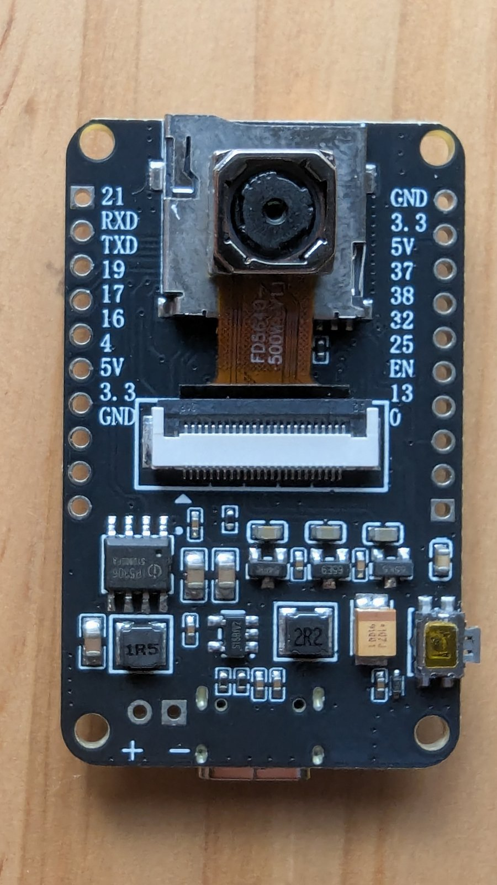
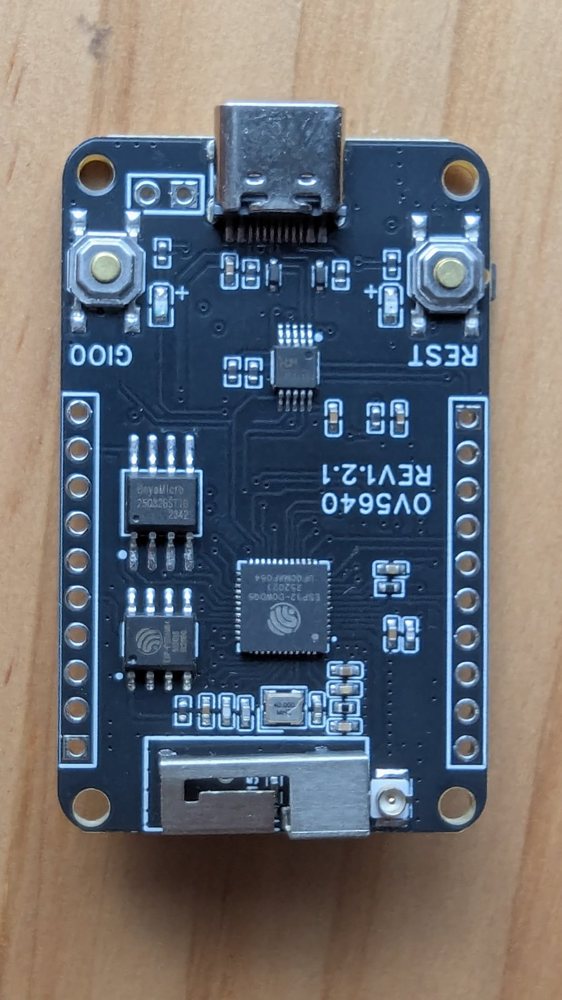
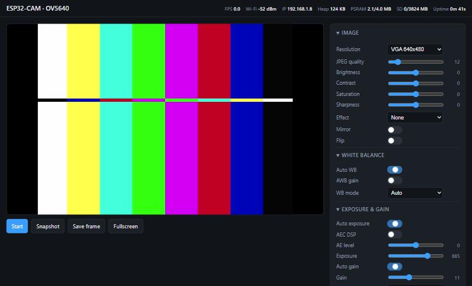

# ESP32-CAM "OV5640 REV1.2.1" — working pinout, quirks and a web camera firmware

A cheap ESP32-CAM variant with an **OV5640 (5 MP, autofocus) camera, 8 MB PSRAM, USB-C (CH340X),
IP5306 Li-ion charger and a TF slot** is sold on AliExpress with almost no documentation. The
seller's pin table is partly wrong, the usual AI-Thinker ESP32-CAM examples don't work with it, and
even with the right pins the camera behaves strangely at default settings.

This repo documents what **actually** works, verified on real hardware, and ships a ready-to-use
Arduino firmware: MJPEG streaming, a web UI with all camera settings, SD card, OTA updates and
`esp32-cam.local` mDNS name.

<p align="center">
  
  &nbsp;&nbsp;
  
</p>

## Which board is this?

- Listing title: *"OV5640 ESP32 CAM Camera Module Kit Auto Focus AF-72mm 2.4 GHz WiFi and
  Bluetooth-Compatible Board Type C 8MB PSRAM HD 5MP"*
- Bought here: <https://fr.aliexpress.com/item/1005007809356678.html>. The same board shows up
  under other listings, for example [1005004521039608](https://www.aliexpress.com/item/1005004521039608.html).
- Silkscreen: **`OV5640 REV1.2.1`** on the ESP32 side. Buttons are labelled **`REST`** and **`GIO0`**.
- Headers: `21 RXD TXD 19 17 16 4 5V 3.3 GND` and `GND 3.3 5V 37 38 32 25 EN 13 0`.
- Parts: ESP32-D0WDQ6 + external ESP-PSRAM64H (8 MB), 4 MB flash (BoyaMicro 25Q32), CH340X,
  IP5306 (I2C version), OV5640 on a 24-pin FPC, TF slot, a big FPC for a TFT display, LiPo pads `+ −`.

If your board looks like the photos above, this repo is for you.

## TL;DR: what you need to know

1. **Camera pins are NOT the AI-Thinker ones.** XCLK = GPIO15, SCCB = 22/23, no PWDN. See the table below.
2. **Use XCLK = 16 MHz.** At the usual 20 MHz the OV5640 delivers **no JPEG frames at all**. RGB565
   and grayscale do work at 20 MHz. 5–12 MHz gives frames with gaps.
3. **Each camera init is a lottery.** It lands in either a "good" state (steady ~16 fps VGA) or a "bad"
   one (truncated JPEGs, ~1 fps). The firmware self-tests after init and re-inits until it's good,
   usually within 1–3 attempts.
4. **TF card works in SPI mode with MOSI=21, CS=19.** The seller's table has these two swapped.
5. **The USB auto-reset doesn't put the chip into the bootloader.** The CH340X only drives EN, not
   GPIO0. For USB flashing: **hold GIO0 → press & release REST → release GIO0**. After the first
   flash, use **OTA over Wi-Fi**.
6. **Camera data lines sit on strapping pins** (D0 = GPIO2, D3 = GPIO12). A running camera can
   leave GPIO12 high at reset, which selects 1.8 V flash → `flash read err` boot loop. Fix: burn
   the flash-voltage eFuse to 3.3 V, see [docs/FLASHING.md](docs/FLASHING.md).
7. **IP5306 answers on I2C 0x75** (SDA=13, SCL=4). Those are the **same pins as the SD card**.

## Pinout (verified)

### OV5640 camera

| Signal     | GPIO | `camera_config_t` |
|------------|-----:|-------------------|
| XCLK       | 15   | `pin_xclk`        |
| SIOD (SDA) | 22   | `pin_sccb_sda`    |
| SIOC (SCL) | 23   | `pin_sccb_scl`    |
| VSYNC      | 18   | `pin_vsync`       |
| HREF       | 36   | `pin_href`        |
| PCLK       | 26   | `pin_pclk`        |
| RESET      | 5    | `pin_reset`       |
| PWDN       | —    | `-1`              |
| D0 (Y2)    | 2    | `pin_d0`          |
| D1 (Y3)    | 14   | `pin_d1`          |
| D2 (Y4)    | 35   | `pin_d2`          |
| D3 (Y5)    | 12   | `pin_d3`          |
| D4 (Y6)    | 27   | `pin_d4`          |
| D5 (Y7)    | 33   | `pin_d5`          |
| D6 (Y8)    | 34   | `pin_d6`          |
| D7 (Y9)    | 39   | `pin_d7`          |

### Everything else

| Function                   | GPIO                                   | Status |
|----------------------------|----------------------------------------|--------|
| TF card (SPI)              | SCK=4, MISO=13, **MOSI=21, CS=19**     | ✅ SDHC 4 GB, read/write OK |
| IP5306 (I2C 0x75)          | SDA=13, SCL=4 (shared with TF card!)   | ✅ responds; battery readout not implemented |
| PSRAM                      | 16, 17 (also on the header, don't use) | ✅ 4 MB usable |
| LED                        | 25 (also on the TFT connector)         | not verified visually |
| TFT FPC connector          | 25, 32, 37, 38                         | not tested |
| Buttons                    | REST = EN, GIO0 = GPIO0                |        |
| UART0                      | TX=1, RX=3 (via CH340X)                | ✅ |

Copy-paste version: [`firmware/esp32_cam_web/board_pins.h`](firmware/esp32_cam_web/board_pins.h).

More details, including how each line was verified: [docs/HARDWARE.md](docs/HARDWARE.md).

## Firmware features



- MJPEG stream on `http://esp32-cam.local:81/stream`, ~16 fps at VGA / HD
- Web UI on `http://esp32-cam.local/`: stream, snapshot, save frame, fullscreen, **all** sensor
  settings (resolution, quality, brightness/contrast/saturation/sharpness, effects, white balance,
  exposure, gain, BPC/WPC/gamma/lens correction, mirror/flip, color bars, LED)
- Camera self-test + auto re-init on boot; "Restart camera" button in the UI
- SD card mount + write/read test, I2C scan
- OTA update over HTTP (`POST /update`)
- Diagnostic endpoints to explore similar boards: GPIO activity counter, camera parameter tester,
  SD pin brute-forcer (see below)

## Quick start

Tested with **ESP32 Arduino core 3.3.12** and **arduino-cli 1.6.0** (the one bundled with Arduino IDE 2.x) on Windows 11.

1. Install the ESP32 Arduino core (Boards Manager → *esp32 by Espressif Systems*, 3.x).
2. Copy `firmware/esp32_cam_web/secrets.example.h` → `secrets.h` and set your Wi-Fi SSID and password.
3. Board settings, either in Arduino IDE or via the FQBN:
   - Board: **ESP32 Dev Module**
   - PSRAM: **Enabled**
   - Partition scheme: **Minimal SPIFFS (1.9MB APP with OTA)**, needed for OTA
   - FQBN: `esp32:esp32:esp32:PSRAM=enabled,PartitionScheme=min_spiffs`
4. **First flash over USB.** Put the board into the bootloader by hand: **hold GIO0, press and
   release REST, release GIO0**. Then upload (Arduino IDE *Upload*, or `tools\build_upload.cmd -Usb`).
   If the IDE upload fails with *"Wrong boot mode detected"*, the board wasn't in the bootloader;
   repeat the button sequence.
   Press REST afterwards (or let the script do it).
5. Open the serial monitor at 115200. You should see something like:
   ```
   [I2C] SDA=13 SCL=4: 0x75
   [SD] type SDHC, card 3840 MB, FS 3824 MB, used 0 MB
   [WiFi] connected, IP 192.168.1.x, RSSI -55 dBm
   [CAM] sensor PID=0x5640 (OV5640=0x5640)
   [CAM] self-test: 63 ms/frame, size 8011..10823 -> OK
   [CAM] camera ready (attempt 1)
   Ready! Open http://esp32-cam.local  (or http://192.168.1.x)
   ```
6. Open **http://esp32-cam.local** in a browser.
7. Next updates go over Wi-Fi: `tools\build_upload.cmd` (Windows). On other OSes:
   ```
   arduino-cli compile -b esp32:esp32:esp32:PSRAM=enabled,PartitionScheme=min_spiffs --build-path build firmware/esp32_cam_web
   curl --data-binary @build/esp32_cam_web.ino.bin http://esp32-cam.local/update
   ```

## HTTP endpoints

| Endpoint | Description |
|----------|-------------|
| `GET /` | Web UI |
| `GET :81/stream` | MJPEG stream (separate server so it doesn't block the controls) |
| `GET /capture` | Single JPEG |
| `GET /status` | JSON: all sensor settings + FPS, RSSI, heap, PSRAM, SD, uptime |
| `GET /control?var=<name>&val=<n>` | Change a setting (same names as in `/status`). Extra: `reinit`, `reboot`, `led` |
| `POST /update` | OTA: raw `.bin` as the request body |
| `GET /sd` | SD card info + I2C scan result |
| `GET /camtest?xclk=16&fs=10&fmt=4&swap=0&ifs=23&keep=0` | Re-init the camera with custom XCLK (MHz), frame size, pixel format (4=JPEG, 0=RGB565, 3=GRAY), VSYNC/HREF swap and report the frames that arrive |
| `GET /diag` | Toggle counter for every GPIO, to see which pins carry camera signals |
| `GET /sdprobe?pins=4,13,19,21` | Try every SPI assignment of the given pins until the TF card mounts |

Serial command: send `flash` + Enter. The firmware stops the camera and holds it in reset, so the
strapping pins are clean for USB flashing (see [docs/FLASHING.md](docs/FLASHING.md)).

## Camera results

At **XCLK 16 MHz, JPEG**:

| Frame size | Result | Frame time |
|------------|--------|-----------|
| 96x96 … HVGA 480x320 | ✅ | — |
| VGA 640x480 | ✅ | 63 ms (~16 fps) |
| SVGA 800x600 | ❌ no frames | |
| XGA 1024x768 | ✅ | |
| HD 1280x720 | ✅ | 61 ms (~16 fps) |
| SXGA 1280x1024 | ✅ | |
| UXGA 1600x1200 | ✅ | 349 ms (~3 fps) |
| FHD 1920x1080 | ✅ | |
| P_HD 720x1280, P_3MP 864x1536 | ❌ no frames | |
| QXGA 2048x1536 | ❌ no frames | |
| QHD 2560x1440, WQXGA 2560x1600, P_FHD 1080x1920 | ✅ | |
| QSXGA 2560x1920 | ✅ | 349 ms (~3 fps) |
| 5MP 2592x1944 | ❌ no frames | |

XCLK sweep, the reason for 16 MHz, and the details of the "init lottery":
[docs/CAMERA.md](docs/CAMERA.md).

## Not done / open questions

- **Autofocus.** The OV5640 AF module needs its focus firmware uploaded to the sensor. Not implemented here.
- **Battery level / charging state** from the IP5306. It answers on I2C, but shares pins with the
  SD card, so reading it means unmounting the SD card briefly.
- **TFT connector** and the LED on GPIO25 weren't tested.
- The root cause of the XCLK sensitivity and the init lottery is unknown. Probably PCLK/data
  timing on the I2S camera interface of the classic ESP32. If you find a register tweak that fixes
  it, PRs are welcome!

## Repository layout

```
firmware/esp32_cam_web/   Arduino sketch (board_pins.h has the pin map)
tools/                    build_upload.ps1/.cmd (build + OTA/USB flash), serial_log.py
docs/HARDWARE.md          board details, how the pinout was verified, seller table errata
docs/CAMERA.md            XCLK sweep, frame sizes, init lottery
docs/FLASHING.md          bootloader entry, strapping pins, eFuse, OTA
```

## License

MIT, see [LICENSE](LICENSE).
